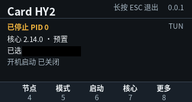
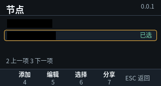
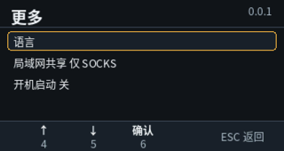

# Card HY2

Card HY2 是面向 CardputerZero（ARM64）的第三方 Hysteria 2 客户端，由独立开发者制作，非 Hysteria 官方出品。它可以在设备屏幕上管理节点和启停代理，也支持通过 ZeroDesk 或 SSH 操作。Hysteria 核心由 systemd 和独立的非 root 账号管理，关闭界面后，已启动的代理会继续运行。

源代码托管在 [Moeyuuko/card-hy2](https://github.com/Moeyuuko/card-hy2)。

## 实机截图

| 首页 | 节点管理 | 更多设置 |
| --- | --- | --- |
|  |  |  |

## 功能

- 手动添加、编辑和切换节点。配有摄像头的设备可扫描 `hysteria2://` 或 `hy2://` 节点二维码，也可生成二维码分享。
- 支持 SOCKS5 和本机 TUN。SOCKS5 默认监听 `127.0.0.1:1080`，可按需开启局域网共享。
- 安装包自带 Hysteria 2 核心。可在设备上检查更新，更新后若代理启动验证失败，会尝试回退到上一版核心。
- 可选择开机启动，也可用「恢复网络」停止代理并清除已应用的代理设置。节点和核心会保留。

## 安装

将 ARM64 的 `.deb` 复制到 CardputerZero，在包所在目录运行以下命令。已有旧版可用同一条命令升级。

```sh
sudo apt install ./card-hy2_0.0.2_arm64.deb
```

从源码构建时，在开发机的仓库根目录运行 `python3 packaging/build_deb.py`。安装包会生成在 `dist/`。

## 快速开始

1. 在设备 HOME 打开 **Card HY2**，或在 ZeroDesk 的 **Screen → Run an app** 中启动。
2. 按 **4 节点**，再按 **4 添加**。可手动填写服务器地址和认证信息，有摄像头的设备也可以扫码。保存后选中节点并按 **6**。
3. 回到首页，按 **5 模式**选择 SOCKS，再按 **6 启动**。首页会显示代理状态和正在使用的节点。
4. 按 **8 更多**可切换语言、配置局域网共享与开机启动，或恢复网络。长按 **ESC** 退出 App。

在 ZeroDesk 的 Shell 或 SSH 中，也可用 `card-hy2 status` 查看状态，或用 `card-hy2 recover` 恢复网络。更多键位、配置路径和故障排查见[使用手册](docs/card-hy2-beta.md)。

## 许可证

Card HY2 自身的代码以 [MIT](LICENSE) 许可发布。

代理核心由 Hysteria 项目维护，安装包附带其许可证。[Hysteria 2](https://github.com/HyNetworks/hysteria) · [核心许可证](packaging/hysteria-LICENSE.md)
